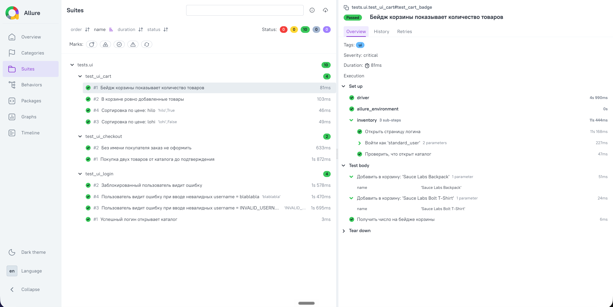

# Автотесты UI для интернет-магазина [saucedemo.com](https://www.saucedemo.com).

## Стек

- **Python 3.11**, **pytest**
- **Selenium 4** + **PageObject** 
- **Allure Report**
- **pytest-xdist** 
- **GitHub Actions**
- **Jenkinsfile**

## Запуск локально

```bash
python -m venv .venv && source .venv/bin/activate
pip install -r requirements.txt

pytest -m ui                      
pytest -m "ui and smoke" --headless     # UI smoke без окна браузера
pytest -n auto                          # параллельно
```

### Отчёт о прогоне

[](https://gorkovanton.github.io/autotests_ui/)

В CI результаты сохраняются как артефакт `allure-results` (вкладка Actions → запуск → Artifacts).

Настроен Jenkinsfile для запуска автотестов в Jenkins.